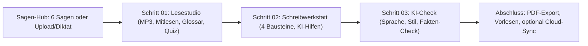
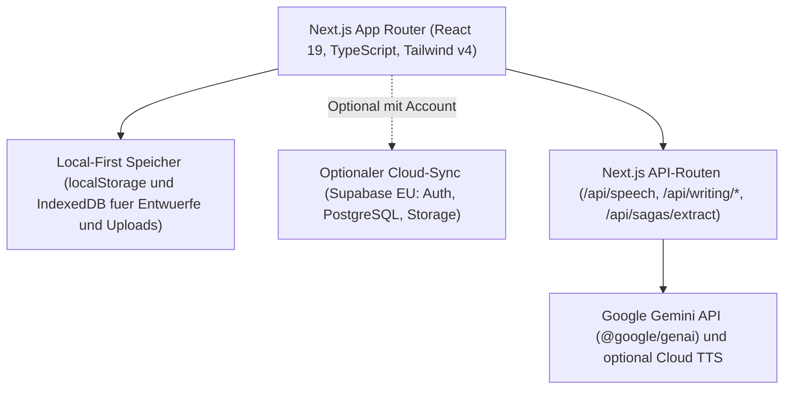

# Projekt-Roadmap: Emsny Sagen-Studio (Lesestudio & Schreibwerkstatt)

> [!NOTE]
> **Bestandsaufnahme beider Prototypen:** Nach der Analyse deines **Sagen-Werkstatt-Prototyps (HTML)** und deines bestehenden **`sagen-lesestudio`-Repositories (React 19 + TypeScript + Tailwind v4)** zeigt sich: Beide passen wie zwei Puzzleteile zusammen. Ein Großteil von Schritt 01 (strukturierter Sagen-Katalog, 6 MP3-Hörbücher mit exakten Timings, Kindle-Lesemodus, 6 Papiertöne, HD-TTS und Diktier-Modal) existiert bereits in hoher Qualität und lässt sich direkt in die neue gemeinsame **Next.js-App** übernehmen.

---

## 1. Gemeinsame Produktvision & Lernreise

Ein durchgehender, ruhiger Lernfluss für einzelne Schüler:innen (6. Schulstufe AHS / B2-Niveau) – **sofort ohne Login nutzbar** (lokal gespeichert) mit **optionalem Cloud-Konto** für Laptop, iPad/Tablet und Smartphone.

---

## 2. Was wir direkt übernehmen vs. neu bauen & reparieren

| Bereich | Bereits vorhanden (Prototyp / `sagen-lesestudio`) | Ziel in der neuen gemeinsamen Next.js-App |
| :--- | :--- | :--- |
| **Sagen-Datenbasis** | `SAGEN_CATALOG` mit allen 6 Sagen, 4 Aufbausteinen, ausführlichem B2-Glossar, je 3 Verständnisaufgaben & Musterlösungen | Als **einzige Datenquelle (Single Source of Truth)** für Lesen *und* Schreiben nutzen (ersetzt das duplizierte Markdown im HTML-Prototyp) |
| **Audio & Synchron-Lesen** | 6 MP3s in `public/audio/`, `audioTimings`, `audioSpeechSpans`, `useSagaAudioPlayer` (`requestAnimationFrame`-Wort-Sync), 6 Kindle-Farbschemata | 1:1 portieren und um nahtlosen Übergang *„Jetzt nacherzählen →“* ergänzen |
| **HD-TTS & Diktat** | `src/server/speech-api.ts` (Chirp 3 HD + `gemini-3.8-flash-lite-tts`/`gemini-3.8-flash-tts`) + `DictationModal.tsx` (`de-AT`/`de-DE`) | `/api/speech` von Vite-Dev-Middleware zu echter **Next.js API-Route** machen; Diktierfunktion zusätzlich direkt in jedem Schreib-Abschnitt nutzbar machen |
| **Begriffe vereinheitlichen** | Lesestudio: *Einführung / Thema / Wende / Bleibendes* · Werkstatt: *Einleitung / Aufbau / Höhepunkt / Ausklang* | Durchgängige, konsistente Benennung über Schritt 01 & Schritt 02 (z. B. *01 Einführung · Ort, Zeit & Personen*) |
| **Schreib-Editor & Touch-UX** | 4 Karten, Satzanfänge, Ghost-Text, Wortarten-Synonyme, PDF-Export – aber fixe Textarea-Höhe, statische Stats, keine echte Speicherung, keine Touch-Buttons | Stabiler Editor (Auto-Grow + zuverlässige Inline-Markierungen), echtes **Local-First Auto-Save**, Touch-Buttons (*Übernehmen ✓ / Neue Idee ↻*) für iPad & Smartphone |
| **KI-Coach & Sicherheit** | Direkter Browser-Fetch ohne API-Key-Schutz; noch kein Inhalts-/Präteritum-Check; veraltetes Re-Highlighting nach Korrektur | Einheitliches **Next.js Gemini-Backend** (`@google/genai`), Rate-Limiting, `store: false` (DSGVO), echter **Fakten- & Sagen-Check**, Präteritum-Coach & wählbare Hilfestufen |
| **PWA & Mobilgeräte** | `manifest.webmanifest` und App-Icons (`192`/`512`/Apple-Touch) bereits im `sagen-lesestudio` | Direkt übernehmen, sodass Schüler:innen die App am iPad/Smartphone wie eine native App auf den Homescreen legen können |

---

## 3. Ziel-Architektur & Tech-Stack

### Konkrete Technik-Entscheidungen
* **Framework:** **Next.js (App Router, TypeScript, Tailwind CSS v4)** + bestehende UI-Primitives (`lucide-react`, `sonner`, `class-variance-authority`, `clsx`, `tailwind-merge`) aus `sagen-lesestudio`.
* **Routes / App-Struktur:**
  * `/` — **Sagen-Hub** (Katalog mit Kategorien, Suche, eigenem Fortschritt *Gelesen / In Arbeit / Fertig*, Datei-Upload & Diktat).
  * `/sage/[id]/lesen` — **Schritt 01: Lesestudio** (Kindle-Buch- & Fließtextansicht, MP3-Sync-Player, Glossar, Verständnisaufgaben, Button *„Weiter zur Schreibwerkstatt“*).
  * `/sage/[id]/schreiben` — **Schritt 02: Schreibwerkstatt** (4 Bausteine, Live-Statistiken, Original-Sage-Drawer, KI-Hilfen, Checkliste, KI-Analyse, PDF-Export).
  * `/portfolio` — **Meine Sagen** (alle lokal/cloud gespeicherten Nacherzählungen, eigene Uploads, JSON-Backup & optionaler Account-Sync).
* **Editor-Komponente:** **TipTap (ProseMirror)** für die 4 Schreibfelder – verhindert das Scroll-/Höhen-Problem der überlagerten `<textarea>`-Layer und macht farbige Markierungen (Fehler, Verben, Adjektive), Synonym-Popovers und Inline-Ghost-Text auf Desktop, iPadOS und Smartphone absolut stabil.
* **Einheitliches KI-Backend (`@google/genai` >= 3.2.0 in Next.js Route Handlers):**
  * `/api/speech` — Portierung deiner bestehenden `speech-api.ts` (Chirp 3 HD + `gemini-3.8-flash-lite-tts` / `gemini-3.8-flash-tts` Fallback + LRU-Cache), funktioniert damit erstmals auch produktiv im Web ohne eigenen Schüler-API-Key.
  * `/api/writing/starters` & `/api/writing/continue` & `/api/writing/synonyms` — `gemini-3.5-flash-lite` (blitzschnell & kostengünstig für häufige Schreibhilfen).
  * `/api/writing/analyze` & `/api/writing/fact-check` & `/api/sagas/extract` — `gemini-4-hydrogen` mit striktem JSON-Schema (Zod-validiert) für Rechtschreibung/Grammatik, Präteritum-Check, Faktenabgleich mit der Original-Sage und OCR aus PDF/Foto.
  * **Datenschutz (DSGVO):** Alle Gemini-Aufrufe laufen serverseitig mit `store: false`, ohne Klarnamen und mit Rate-Limiting.
* **Speicher-Strategie (Hybrid – ohne Login-Zwang):**
  * **Standard (ohne Login):** Sofortiges Auto-Save aller Entwürfe, Checklisten, Reader-Einstellungen, Quiz-Fortschritte und hochgeladenen Sagen im Browser (`localStorage` + `IndexedDB` für größere Uploads).
  * **Optionaler Account (Phase 3):** Freiwillige Anmeldung (z. B. Magic-Link via **Supabase EU**) zum geräteübergreifenden Sync zwischen Laptop, iPad und Smartphone inkl. nahtloser Übernahme aller lokal begonnenen Texte.

---

## 4. Phasen-Roadmap (beschleunigt durch bestehenden Code!)

Da ein Großteil des Lesestudios bereits fertig ist, kommen wir deutlich schneller zu einer nutzbaren Version.

### Phase 0: Projekt-Setup & Portierung des Fundaments *(erledigt)*
Ziel: Lauffähiges Next.js-Projekt mit allen Daten, MP3s, Themes und Tests aus `sagen-lesestudio`.

* [x] Next.js 16 (App Router, TypeScript, Tailwind v4) & Vitest im Workspace initialisiert.
* [x] `public/audio/*.mp3`, PWA-Icons & `manifest.webmanifest` aus `sagen-lesestudio` übernommen.
* [x] `src/data/sagen-catalog.ts` als zentrale Datenbasis übernommen und einheitliche Abschnitt-IDs (`einfuehrung`, `thema`, `wende`, `bleibendes`) ergänzt.
* [x] Gemeinsames Design-System (6 Reader-Papiertöne + warmer Emerald/Slate-Look) & Navigation (*Alle Sagen · 01 Lesen · 02 Schreiben · Portfolio · Menü*) umgesetzt.
* [x] Serverseitiger Gemini-Client (`@google/genai`), `/api/speech`, `/api/key` (inkl. Eingeben/Ändern/Löschen über Menü) und Rate-Limiting eingerichtet.

---

### Phase 1: MVP – Nahtlose Verbindung von Lesestudio & Schreibwerkstatt *(erledigt)*
Ziel: Kompletter Durchlauf von Auswahl → Lesen/Hören → Schreiben → PDF-Export – 100 % ohne Login nutzbar und lokal gespeichert.

#### Sagen-Hub & eigener Upload
* [x] Erweiterter `SagenHub` als Startseite mit Suche, Kategorien, Fortschritts-Badges (*Gelesen*, *X/4 Abschnitte*, *Check %*) und Schnellwahl *01 Lesen* vs. *02 Schreiben*.
* [x] Upload eigener Sagen (`.txt`, `.pdf`, Bild/Foto) über `/api/sagas/extract` (Gemini-OCR + lokaler `.txt`-Fallback).
* [x] Bestehendes `DictationModal` im Hub als *„Sage einsprechen“* integriert.

#### Schritt 01 – Integriertes Lesestudio (`/sage/[id]/lesen`)
* [x] `SpeechReader`, `useSagaAudioPlayer`, `ReaderSettingsDialog` und `HdVoiceSelect` in `/sage/[id]/lesen` integriert.
* [x] **Interaktive Glossar-Markierung:** B2-Glossarbegriffe direkt im Sagentext (ohne Layout-Shift) anklickbar mit schwebender Worterklärung.
* [x] **Verständnis-Check-Fortschritt** lokal gespeichert und klarer CTA: *„Verstanden – Jetzt selbst nacherzählen“*.

#### Schritt 02 – Schreibwerkstatt-Upgrade (`/sage/[id]/schreiben`)
* [x] 4-Abschnitte-Editor mit Auto-Grow, stabilem Review-Highlighting und sofortigem Local-Auto-Save pro Sage.
* [x] **Dynamische Kennzahlen & Navigation:** Echte Wörterzahl, berechnete Lesezeit, `Abschnitte begonnen (X/4)`, persistierter Fakten-Check und klickbare Fortschritts-Tabs.
* [x] **Touch- & Desktop-Schreibhilfen:**
  * *Satzanfänge* (`/api/writing/starters`) als Touch-Chip-Leiste.
  * *Weiter schreiben* (`/api/writing/continue`) mit Inline-Vorschlag + Touch-Buttons (**Übernehmen**, **Andere Idee**, **Verwerfen**) sowie `Tab` / `Strg+M`.
  * **Eingebaute Diktier-Taste** pro Abschnitt (`de-AT`).
* [x] *Original-Sage*-Modal inkl. B2-Glossar, Verständnisaufgaben und Sprung ins Lesestudio.
* [x] **Eigene Sage vorlesen lassen** via `/api/speech`.
* [x] Sauberer **Druck- & PDF-Export** (A4-Layout inkl. Sagentitel, 4 Bausteine, Wörterzahl und Glossar-Anhang).

---

### Phase 2: KI-Coach, Fakten-Check & Pädagogik *(erledigt)*
Ziel: Alle Analyse-Features aus dem Prototyp stabilisieren und um echte pädagogische Tiefe erweitern.

* [x] **Stabile Sprach- & Wortarten-Analyse (`/api/writing/analyze`):**
  * Rechtschreib-, Grammatik-, Zeitform- & Satzbaufehler mit nummerierten Badges, kindgerechten Erklärungen und konsistenter Einzel-/Sammel-Korrektur.
  * Verben (blau) & Adjektive (grün) direkt antippbar für 4 altersgerechte Synonyme (`/api/writing/synonyms`).
* [x] **Echter Fakten- & Sagen-Check (integriert in `/api/writing/analyze`):**
  * Abgleich gegen die Original-Sage inkl. Score (0–100%), fehlenden Handlungsdetails und Eigenständigkeits-Hinweis.
  * Automatische Synchronisation mit der Checkliste (*„Ist deine Sage rund?“*) und Speicherung im Portfolio.
* [x] **Präteritum- & Stil-Coach:** Erkennt Zeitensprünge (`zeitform`) und gibt konkrete Stil-Tipps.
* [x] **Pädagogische Hilfestufen:** Umschaltbar zwischen *Starter*, *Standard* (max. 2 KI-Schubser) und *Profi*.

---

### Phase 3: Optionaler Cloud-Account & Portfolio *(erledigt / bereit zur Supabase-Aktivierung)*
Ziel: Geräteübergreifendes Weiterarbeiten für alle, die es möchten – bei weiterhin 100 % nutzbarem Gast-Modus.

* [x] **Mein Sagen-Portfolio (`/portfolio`):** Lern-Dashboard (gelesene Sagen, Wörter, komplette Sagen, Ø Fakten-Check, Aufgaben) + JSON-Backup **Export & Import** für reine Gast-Nutzer.
* [x] **Optionaler Cloud-Sync (Supabase EU):** Magic-Link-Login, Gast-zu-Account-Merge nach Zeitstempel (`src/lib/cloud-sync.ts`) und fertiges RLS-Datenbankschema (`supabase/schema.sql`).
* [x] **Server-Caching für TTS & KI-Analysen:** LRU-Cache aktiv in `speech-api.ts` (TTS) und `/api/writing/analyze` (10 Min. TTL gegen doppelte Token-Kosten).

---

### Phase 4: Datenschutz, Geräte-Tests & Launch *(bereit fürs Deployment)*
Ziel: Produktionsreifer Start für Schüler:innen.

* [x] **DSGVO & Jugendschutz-Seite (`/datenschutz`):** Transparente, kindgerechte Info zu lokaler Speicherung, API-Key, KI-Nutzung (`store: false`) und bestätigter 1-Klick-Löschfunktion für alle lokalen Daten.
* [x] **Automatisierte Tests & Build-Verifikation:** TypeScript (`0` Fehler), Vitest (`30/30` Tests grün, inkl. Live-Diktat, österreichische Satzzeichen-Befehle & Verbatim-Guard) und Next.js 16 Produktions-Build aller Seiten & API-Routen.
* [ ] **Live-Deployment & Praxistest:** Deployment (z. B. Vercel + optional Supabase EU) und Testlauf mit echten Schüler:innen der 6. Schulstufe.

---

### Spätere Ideen (Post-Launch / v2)
* **KI-Deckblatt-Illustration** (`gemini-nano-banana-2.1`) zur eigenen Sage für den PDF-Export.
* **Teilen per Kurz-Link:** Lehrkräfte oder Eltern können eigene Sagen als Übungs-Link weitergeben.
* **Weitere Textsorten:** Gleiche 2-Schritt-Struktur für Fabeln, Märchen oder Bildgeschichten.

---

## 5. Risiken & Gegenmaßnahmen

| Risiko | Konkrete Lösung |
| :--- | :--- |
| **Desync zwischen Text & farbigen Highlights** | Wechsel von überlagerten `<textarea>`-Layern auf **TipTap** (ein einziges Dokumentmodell für Text, Fehler-Badges, Wortarten & Synonyme) |
| **MP3-Hörbuch vs. TTS-Dateigrößen & Kosten** | Die 6 fertigen MP3s bleiben statisch/kostenlos im CDN; Gemini-TTS wird nur bei eigenen Uploads, Schülertexten oder alternativen Stimmen genutzt und serverseitig gecacht |
| **Missbrauch offener API-Routen (Gast-Modus)** | Strenges IP-/Session-Rate-Limiting (z. B. Upstash/In-Memory), Textlängen-Limits, kostengünstiges `gemini-3.5-flash-lite` für häufige Schreibhilfen |
| **DSGVO bei Minderjährigen (11–12 Jahre)** | Volle Nutzbarkeit *ohne* Account; bei optionalem Konto EU-Server, Pseudonym-Prinzip und `store: false` bei Gemini |

---

## 6. Offene Mini-Entscheidungen vor dem Start von Phase 0

1. **Optionales Cloud-Backend (für Phase 3):** **Supabase (EU)** *(Empfehlung)* oder **Firebase**?
2. **Einheitliche Benennung der 4 Sagen-Bausteine:** Lieber die Schulbuch-Begriffe aus dem Lesestudio (*Einführung · Thema · Wende · Bleibendes*), die moderneren Begriffe aus der Werkstatt (*Einleitung · Aufbau · Höhepunkt · Ausklang*), oder beides kombiniert (z. B. *01 Einführung – Ort, Zeit & Personen*)?
3. **Bereit für den Start?** Wenn dir die Roadmap so passt, speichere ich sie als `ROADMAP.md` direkt in deinem Projektordner und wir können mit **Phase 0** loslegen!
